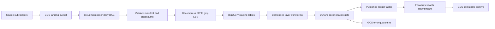
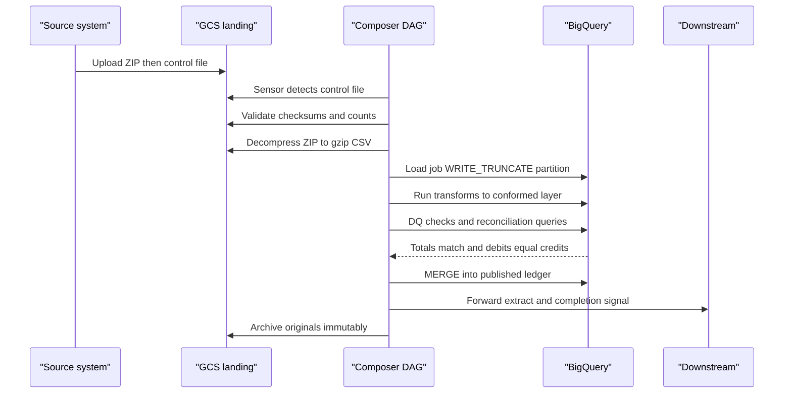
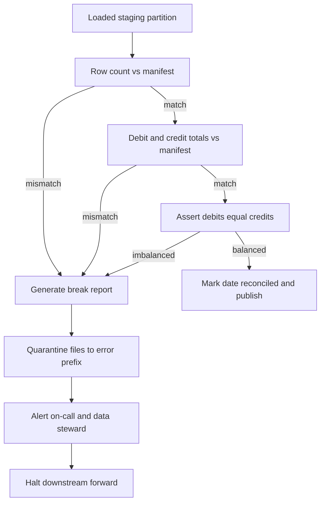

# The Daily Ledger Pipeline, End to End

## 1. The Business Problem

Every large bank must be able to answer one question at any moment: *what is our financial position, and can we prove it?* The system of record for that answer is the **general ledger (GL)** — the master set of accounts in which every financial event the bank participates in is ultimately recorded. The GL is not populated by hand. It is fed by dozens of **sub-ledgers**: specialized systems that record one class of activity in detail — the loans book, the cards platform, treasury, trade finance, payments. Each sub-ledger periodically summarizes its activity and posts it to the GL as **journal entries**.

A journal entry is the atomic unit of accounting. It records a financial event as a set of line items, each of which **debits** or **credits** a specific account. The foundational rule of **double-entry bookkeeping** is that within every journal entry, *the sum of debits must equal the sum of credits*. This is not a stylistic convention; it is an invariant that makes the ledger self-checking. If a customer repays £1,000 of a loan, the loans sub-ledger posts a journal that debits cash (an asset increases) and credits the loan receivable (another asset decreases) — £1,000 on each side. When millions of such entries are aggregated, the invariant must still hold. Any imbalance — called a **break** — means data was lost, duplicated, or corrupted somewhere between the source system and the ledger, and it must be found and explained.

Why does this happen *daily*, and why does it happen under time pressure?

- **Regulatory reporting.** Prudential regulators require regular, accurate positions (capital ratios, liquidity, large exposures). Regimes such as BCBS 239 explicitly demand that banks can aggregate risk and finance data accurately and quickly, with documented lineage.
- **Audit.** External auditors must be able to trace any GL balance back through journal entries to source-system transactions. That traceability — the **audit trail** — has to be built into the pipeline, not reconstructed after the fact.
- **Month-end close.** At the end of each accounting period the books are "closed": balances are finalized, adjustments posted, and statements produced. A close is only as smooth as the daily feeds that preceded it. Every unresolved daily break becomes a month-end fire drill, and month-end is exactly when volumes spike and deadlines are hardest.

So the pipeline has two masters that are usually in tension: **timeliness** (finance users and downstream systems need yesterday's positions by a fixed cut-off this morning) and **correctness** (a fast wrong number is worse than a slow right one, because wrong numbers propagate into regulatory filings). The entire design that follows — control files, reconciliation gates, idempotent stages, immutable archives — exists to satisfy both masters at once. Correctness is enforced by machine-checkable invariants; timeliness is bought by automation and predictable recovery when something fails.

## 2. The Daily Feed

Each source system delivers a **batch feed** once per **business date** — the accounting date the data belongs to, which is distinct from the calendar date on which the file physically arrives (a feed for Friday's business may land on Saturday morning, or on Monday after a failure).

A well-designed feed is never just "a file." A typical delivery consists of:

- **Data files** — CSV, usually compressed into a ZIP archive, one or more per feed (e.g., journals, balances, account master).
- A **control file** (also called a **manifest** or trailer file) — a small companion file stating what the sender believes it sent: the list of data files, the row count of each, file checksums (MD5/SHA-256), and **control totals** such as the sum of all debit amounts and the sum of all credit amounts.
- A **naming convention** that encodes provenance and business date, e.g. `GL_JOURNALS_20260714_v01.zip` and `GL_JOURNALS_20260714_v01.ctl`. The business date in the name is load-bearing: it is what lets the pipeline route data to the correct partition and detect duplicate or late deliveries.

The receiving side is a **Google Cloud Storage (GCS)** bucket organized into lifecycle prefixes:

| Prefix | Purpose |
|---|---|
| `landing/` | Where the sender (SFTP bridge, transfer service) drops files. Nothing downstream reads from here except the intake step. |
| `processing/` | Files are moved here atomically once intake claims them, so a half-uploaded file is never processed and a rerun never double-claims. |
| `archive/YYYY/MM/DD/` | Immutable copy of every successfully processed file, retained for audit (often with a bucket retention policy or object holds). |
| `error/YYYY/MM/DD/` | Quarantine for files that fail validation, kept exactly as received so the failure can be reproduced and disputed with the sender. |

One GCP-specific point that trips people up: **BigQuery can load gzip-compressed CSV natively, but it cannot load ZIP archives.** `bq load` and the load-job API accept plain or gzip CSV from GCS directly; a `.zip` is a container format that BigQuery does not unpack. So the pipeline must include an explicit **decompress stage** — typically an Airflow task (or a small Cloud Run/Dataflow step for very large files) that unzips the archive back into GCS as plain or `.csv.gz` members before the load job runs. Senders who can be persuaded to switch from ZIP to gzip remove an entire stage; most cannot be, so the stage stays.

## 3. Orchestration with Cloud Composer

**Cloud Composer** is Google's managed **Apache Airflow** service: Google runs the Airflow scheduler, workers, webserver, and metadata database on GKE, and you supply **DAGs** — Python files defining a directed acyclic graph of tasks — by dropping them into a GCS bucket that Composer syncs. In Airflow 2.x terms, the daily ledger job is one DAG with a `@daily` schedule, and each box below is a task or task group. Internal frameworks at large banks typically wrap these steps — a config-driven "ingestion framework" generates the DAG from YAML — but the underlying anatomy is always the same.

### The stages of the daily DAG

| Stage | What happens | Typical failure mode | Recovery |
|---|---|---|---|
| 1. File sensing | A deferrable `GCSObjectExistenceSensor` (or event-driven trigger via Pub/Sub) waits for the control file for the run's business date. Sensing the *control* file, not the data file, guarantees the sender has finished uploading. | File never arrives before the SLA timeout. | Sensor times out and alerts; when the file lands late, re-run or clear the sensor task — everything downstream is keyed on business date, so lateness is absorbed. |
| 2. Validation | Parse the manifest; verify every listed file exists, sizes and checksums match, row counts in the trailer match a physical count, business date in filenames matches the run. | Checksum mismatch (truncated transfer), missing member file, wrong-date file. | Move the delivery to `error/`, alert the sender, halt. Nothing was loaded, so recovery is simply a redelivery plus DAG re-run. |
| 3. Decompress | Unzip archives from `processing/` into a `decompressed/` prefix as plain or gzip CSV. | Corrupt archive, disk/memory pressure on the worker for very large files. | Task retry; for chronic size problems, offload to Cloud Run. Re-running just overwrites the decompressed objects. |
| 4. Load to staging | BigQuery load job into a staging table, targeting the business-date partition with **`WRITE_TRUNCATE`** disposition on that partition. | Malformed rows exceed `max_bad_records`; schema mismatch. | Because the partition is truncated on every attempt, a rerun cannot double-load — this is the idempotency workhorse. Schema failures quarantine the file. |
| 5. Transform | Staged SQL (or dbt) builds conformed tables: type casting, dedup, key resolution, SCD2 maintenance. | SQL logic error, unexpected nulls in key columns. | Transforms are `CREATE OR REPLACE` / `MERGE` statements scoped to the business date; rerunning replays them safely. |
| 6. DQ gate | Rule engine checks nulls, referential integrity, valid account codes, amount ranges. | Rules fail. | Halt before publish; see section 5. |
| 7. Reconciliation | Compare loaded totals to manifest control totals; assert debits = credits. | Break detected. | Halt, produce break report, quarantine; see section 5. |
| 8. Publish and forward | `MERGE` conformed data into published tables; export extracts / notify consumers. | Downstream endpoint unavailable. | Retry with backoff; publish itself is a MERGE and safe to repeat. |
| 9. Archive | Move originals from `processing/` to `archive/YYYY/MM/DD/`; record run metadata. | GCS move fails mid-way. | Copies are idempotent (same destination names); rerun completes the move. |

### Scheduling semantics, retries, idempotency, backfill

Airflow's most misunderstood concept is the **logical date** (formerly `execution_date`). A daily DAG run with logical date `2026-07-14` *runs after* that interval closes — i.e., early on the 15th — and represents "the run responsible for the 14th's data." The pipeline maps logical date to business date, so every task derives its file names, partition targets, and SQL predicates from `{{ ds }}` rather than from "today." This single discipline is what makes everything else work: a task that asks "what is the current time?" can never be safely re-run; a task that asks "what is my logical date?" always can.

Every task is configured with **retries** (e.g., 3 attempts with exponential backoff) for transient faults, which means every task *will* sometimes execute more than once — so every task must be **idempotent**: running it twice for the same business date produces the same end state as running it once. The mechanisms are: atomic claim-moves in GCS, `WRITE_TRUNCATE` per partition on load, `MERGE` on publish, and archives keyed by date.

**Backfill** is the payoff. If Tuesday's run failed at the reconciliation gate and was fixed Thursday, you clear the failed tasks (or run `airflow dags backfill -s 2026-07-14 -e 2026-07-14`) and the DAG replays *as of* that logical date — reading Tuesday's files, truncating Tuesday's partition, publishing Tuesday's ledger — without touching Wednesday's or Thursday's data. If runs must be strictly ordered (running balances depend on prior days), `depends_on_past=True` or an explicit external-task dependency enforces the sequence.

## 4. Inside BigQuery

The warehouse is layered — the **bronze/silver/gold** (or **staging/conformed/published**) pattern:

- **Staging (bronze).** Tables that mirror the files exactly: all columns as `STRING`, one table per feed, partitioned by the *feed's* date (ingestion-time partitioning — a file can carry a few backdated lines, and a decorator load into a column-partitioned table would reject them), loaded with `WRITE_TRUNCATE` per partition. No transformation happens here; staging exists so that "what did the file say?" is always answerable in SQL, and so a transform bug never requires re-reading files. The accounting `business_date` column takes over as the partitioning key from the conformed layer onward.
- **Conformed (silver).** Typed, deduplicated, standardized entities: `journal_lines`, `accounts`, `cost_centres`. This is where business keys are resolved and quality rules are applied.
- **Published (gold).** The consumable products: the daily ledger, trial balance, account balance history. Only this layer is exposed to consumers, always through **views**, so the physical tables can be repaired or restated without breaking anyone.

Key techniques in the conformed and published layers:

**Deduplication on natural keys.** Files get redelivered; senders occasionally include overlapping records. The transform deduplicates on the **natural key** of a journal line — typically `(source_system, journal_id, line_number)` — using `ROW_NUMBER() OVER (PARTITION BY key ORDER BY file_load_timestamp DESC) = 1`, keeping the latest arrival. Dedup in SQL, downstream of an idempotent load, is far more robust than trying to prevent duplicates at the file level.

**Running balances.** A ledger is more than a pile of entries; consumers want the balance of each account over time. The published balance table is built with a window function — `SUM(signed_amount) OVER (PARTITION BY account_id ORDER BY business_date)` — or, at scale, incrementally: yesterday's closing balance per account plus today's net movement equals today's closing balance. The incremental form is why strict day-ordering (`depends_on_past`) matters for this table.

**Partitioning and clustering.** Every large table is **partitioned by business date** (a `DATE` column partition, not ingestion time — you want the *accounting* date, and you want to be able to load late data into an old partition). Partitioning gives cheap, precise reprocessing (truncate exactly one day) and cheap queries (scan exactly the dates you need). Tables are additionally **clustered by account identifier**, so the dominant query shape — "this account over this date range" — prunes both dimensions.

**Idempotent publish with MERGE.** The publish step is a `MERGE` statement: match on the natural key, `WHEN MATCHED THEN UPDATE`, `WHEN NOT MATCHED THEN INSERT` (and optionally a delete branch scoped to the business date for rows that vanished on redelivery). MERGE makes publish-twice equal publish-once, which is what allows retries and backfills to touch the gold layer safely.

**SCD Type 2 for master data.** Account attributes (name, hierarchy node, cost centre, status) change over time, and finance must report *as of* a date. The account dimension is therefore maintained as **slowly changing dimension type 2**: each version of an account is a row with `valid_from`, `valid_to`, and `is_current` columns; a change closes the old row and inserts a new one (one MERGE plus an insert, or a two-step MERGE). Fact-to-dimension joins are then range joins on business date, guaranteeing that a journal from March is reported under the account hierarchy that existed in March.

## 5. The Reconciliation and Data-Quality Gate

This gate is the pipeline's conscience, and it sits deliberately *before* publish and forward — the design principle is that **it must be impossible for unreconciled data to leave the platform**.

Two families of checks run:

1. **Data-quality rules** on content: no null natural keys, every account code exists in the account master, currency codes are valid ISO 4217, amounts within sane bounds, business date on every row matches the partition.
2. **Reconciliation** against the sender's control file, at three tightening levels:
   - **Row counts**: rows loaded into staging = row count declared in the manifest.
   - **Control totals**: `SUM(debit_amount)` and `SUM(credit_amount)` over the loaded partition = the totals declared in the manifest (compare as `NUMERIC`, never `FLOAT64` — money is exact-decimal).
   - **The double-entry invariant**: total debits = total credits within the day, and ideally within each journal. This check needs no manifest at all; the data proves or disproves itself.

When any check fails, the pipeline produces a **break report** — a table (and usually an email/Slack artifact) listing, per feed and per check: expected value, actual value, difference, and where possible the offending journals (found by reconciling per journal ID rather than per file). Then three things happen, in order: the delivery is **quarantined** to the `error/` prefix exactly as received; an **alert** pages the on-call engineer and notifies the business data steward who owns the relationship with the sending system; and the DAG **halts before the forward step**, so downstream consumers receive *nothing* for that business date rather than something wrong. Downstream contracts must therefore distinguish "late" from "absent" — a completion signal (a `_SUCCESS` marker object or a Pub/Sub message) tells consumers a date is officially published; its absence tells them to wait.

Breaks are resolved either by **redelivery** (sender's fault — truncated file, wrong extract window) or by an **approved adjustment** (a genuine business condition, booked as a new journal entry, never as an edit to existing data). Either way, resolution ends with re-running the day's DAG from the failed stage, which the idempotent design makes routine.

## 6. Forwarding Downstream and the Audit Trail

Once a business date is reconciled and published, consumers take it in whatever shape they contracted for:

- **Extract files** (CSV/Avro/Parquet exported from BigQuery to a GCS outbound bucket, mirrored with their own manifest and control totals — the pipeline becomes a *sender* and holds itself to the same standard it demands of its sources).
- **Views** in BigQuery, shared via authorized views or Analytics Hub, for consumers inside the same data platform.
- A **completion event** on Pub/Sub carrying the business date and run metadata, so downstream orchestration is event-driven rather than time-guessing.

The audit trail is the sum of deliberate immutability choices:

- **Archived source files are never modified or deleted** within the retention period (bucket retention policies make this enforceable, not just conventional). If an auditor questions a balance from eleven months ago, the exact bytes the sender delivered are still there.
- **Run metadata is recorded per stage**: file names, checksums, row counts, reconciliation results, DAG run IDs, and timestamps go into an audit table in BigQuery. Together with staging tables that mirror files verbatim, this gives row-level **lineage**: any published ledger line traces to a staging row, which traces to a named, checksummed, archived file, which traces to a sender and a delivery time.
- **Reprocessing a bad business date follows a strict protocol**, because published data may already have been consumed: (1) declare the date under restatement and notify consumers via the same signaling channel; (2) obtain the corrected delivery into `landing/`; (3) clear/backfill the DAG for that logical date — load truncates the staging partition, transforms rebuild the conformed slice, reconciliation re-runs against the *new* manifest; (4) MERGE updates the published layer in place; (5) emit a restatement event so consumers re-pull; (6) archive the corrected file *alongside* the original — the bad file is evidence, not garbage. If balances are computed incrementally, all subsequent dates' balance rows are rebuilt forward from the restated date.

## 7. Common Failure Scenarios and How the Design Absorbs Them

| Scenario | What happens without the design | How this design absorbs it |
|---|---|---|
| **Late file** | Jobs run on "today's" data that isn't there; empty or partial loads published. | The sensor waits on the control file with an SLA alert; all logic keys on logical/business date, so when the file lands, the same run simply completes late — or is backfilled next day — into the correct partition. |
| **Duplicate file** (redelivery, sender retry) | Rows double-counted; debits and credits both inflate, sometimes still balancing — the worst kind of wrong. | Atomic claim-move out of `landing/` prevents double-claiming; `WRITE_TRUNCATE` per partition means a re-load replaces rather than appends; natural-key dedup in the conformed layer catches overlap across files; reconciliation against manifest row counts catches inflation. |
| **Schema drift** (sender adds/renames/reorders a column) | Load silently misaligns columns; amounts land in the wrong field. | Loads use an explicit declared schema (never autodetect in production) with header validation against an expected column list in the validation stage; a mismatch quarantines the file before load. Additive, agreed changes are handled by versioned feed contracts and BigQuery's additive schema evolution on staging. |
| **Partial load** (load job dies midway, worker OOM, network blip) | Half a day's journals published; debits ≠ credits downstream. | BigQuery load jobs are atomic — a failed job commits nothing. The retry re-runs `WRITE_TRUNCATE` on the partition. Even if a logic bug loaded a subset, the row-count and control-total reconciliation refuses to publish it. |
| **Backdated adjustments** (finance posts a correction dated three weeks ago) | Historical reports silently disagree with what was previously distributed. | Adjustments arrive as *new journal entries* with an old business date; date-partitioning accepts them into the old partition via the restatement protocol, MERGE updates published tables, balances rebuild forward, and a restatement event tells consumers history changed. Nothing is ever edited in place, so both the before and after states remain auditable. |

## 8. Whiteboarding This in an Interview

### The six-box diagram

Draw left to right: **(1) Source sub-ledgers → (2) GCS landing bucket → (3) Cloud Composer DAG → (4) BigQuery staging → conformed → published → (5) Reconciliation/DQ gate → (6) Downstream consumers**, with two annotations: an *archive* arrow down from the bucket ("immutable, audit") and a *quarantine + alert* arrow down from the gate ("breaks never propagate"). Six boxes, two side-arrows — you can draw it in thirty seconds and hang every deep-dive answer off one of the boxes.

### The 90-second narration

"Sub-ledger systems deliver a ZIP of CSVs plus a control file per business date into a GCS landing bucket. A Cloud Composer DAG — managed Airflow — runs daily keyed on the logical date: it senses the control file, validates checksums and row counts against the manifest, decompresses — because BigQuery loads gzip CSV natively but not ZIP — and loads staging with WRITE_TRUNCATE on that date's partition, which makes the load idempotent. SQL transforms build a conformed layer: typed, deduplicated on natural keys, SCD2 for account master data, and everything partitioned by business date and clustered by account. Before anything is published, a gate reconciles loaded row counts and debit/credit control totals against the manifest and asserts the double-entry invariant — debits equal credits. If it breaks, the delivery is quarantined, a break report is generated, and downstream forwarding halts, so consumers get nothing rather than something wrong. On success, a MERGE publishes to the gold layer, extracts and a completion event go downstream, and the original files are archived immutably for audit. Every stage is rerunnable for its business date, so a failed day is fixed by backfilling that one logical date."

### The five hard follow-ups

**"How do you guarantee exactly-once?"** I don't — I guarantee *effectively-once* through at-least-once execution plus idempotent effects. Airflow retries mean any task may run twice, so every effect is designed to converge: GCS claim-moves are atomic, the staging load is WRITE_TRUNCATE on a single date partition (BigQuery load jobs are themselves atomic — all rows or none), transforms are replace/merge scoped to the date, and the publish is a MERGE on natural keys. Running any stage N times for the same business date yields the same state as running it once, and reconciliation is the independent detector if that ever fails to hold.

**"How do you handle late data?"** By separating business date from processing date. Every file name, partition, and SQL predicate keys on the business date, so a feed that arrives two days late still lands in the right partition — the sensor for that logical date either completes late or the day is backfilled. Backdated adjustments are the harder case: they're accepted as new journals into the old partition under a restatement protocol — republish via MERGE, rebuild running balances forward, and emit a restatement event so consumers know history changed. Nothing is silently rewritten.

**"How do you handle schema evolution?"** Contract-first. Production loads never use schema autodetect; the validation stage compares the file header against the agreed contract and quarantines on any mismatch, because the failure mode of silent drift is amounts landing in wrong columns. Agreed changes are versioned: additive columns are appended to the staging schema (BigQuery supports additive evolution cheaply), the conformed layer maps old and new versions to one model, and consumers see views, so the published interface can stay stable while physical schemas move underneath.

**"What if volume grows 100x?"** The storage and query layers barely notice: GCS and BigQuery load jobs scale horizontally, and partition-plus-cluster pruning keeps query cost proportional to data touched, not table size. The pressure points are the Airflow workers doing decompression — offload to Cloud Run jobs or Dataflow so Composer only orchestrates — the per-file loop (batch many files per load job; BigQuery accepts wildcard URIs), the daily-batch cadence itself (split feeds into intra-day micro-batches per source, still reconciled per business date), and slot capacity for transforms (move from on-demand to reserved slots). The design's key property is that orchestration is separated from computation, so scaling is a matter of swapping executors, not redesigning the flow.

**"How do you monitor it?"** Three layers. *Pipeline health*: Airflow SLAs and task-failure alerts wired to on-call, plus Composer/Cloud Monitoring metrics for scheduler and worker health. *Data health*: the DQ and reconciliation gate is itself monitoring — its results are persisted per run to an audit table, trended, and alerted on, so a slowly rising break rate is visible before it becomes a month-end crisis. *Business health*: freshness SLOs per feed ("business date D published by 07:00 D+1"), with the completion-signal absence itself alertable. The principle is that the pipeline must detect its own failures before a finance user or a regulator does.

---

The design's essence in one sentence: **treat every business date as an idempotent, reconcilable unit of work, and make it structurally impossible for unbalanced or unverified data to reach anyone downstream.** Everything else — bucket prefixes, logical dates, WRITE_TRUNCATE, MERGE, control totals, immutable archives — is machinery in service of that sentence.
